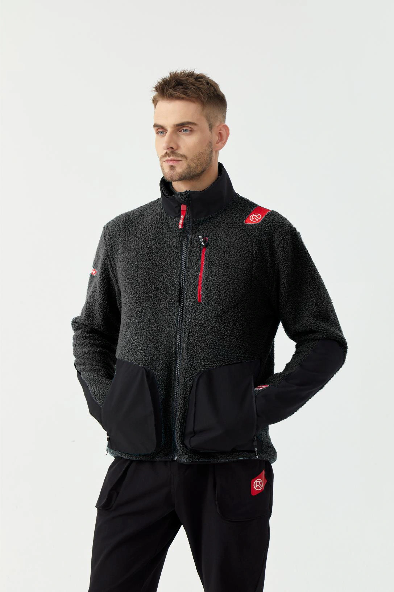
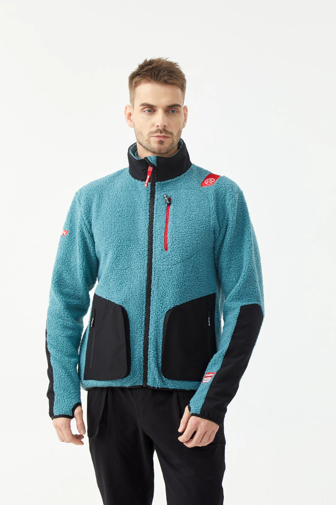

# Alpin Fleece Pro — implemented gallery review

| Colour | Supplier code | Retail price | Selected photos |
|---|---|---|---|
| Black | 25303101 | €146.90 | 6 |
| Emerald Green | 25303102 | €146.90 | 10 |

Actual catalogue galleries and image assets are implemented on this QA branch. Both products remain drafts. XS is unavailable.

### Black — primary photo

### Emerald Green — primary photo

Stock.xlsx column E totals **260 Black / 250 Emerald Green**, whereas the received-stock master totals **224 / 232**. Quantities are documented for review, with no live inventory change. [Size-by-size comparison](catalog-review/alpin-fleece-pro-stock.csv).

## Validation

TypeScript passed. The actual product gallery was exercised at 1440×1000 and 390×844: six Black images, ten Emerald Green images, two colour options, reset to first image after colour change, keyboard navigation, no XS, no horizontal overflow and no browser JavaScript errors. Screenshots were visually inspected. The test used the local application with this catalogue patch; no real services were called. Original gallery components were not changed by this patch.

---

# Alpin Fleece Pro — staged catalogue/image mapping

Status: **internal staging only**. Do not publish, deploy, merge, update live stock, or contact customers without owner approval.

## Confirmed product
- Family: **Alpin Fleece Pro** (13th approved BIG K product family).
- Black: supplier code **25303101**, retail price **EUR 146.90**.
- Emerald Green: supplier code **25303102**, retail price **EUR 146.90**.
- Each size has its own barcode. Barcode identifies the exact colour/size variant; supplier code identifies colour.
- **XS was not ordered**. Supplier-listed XS barcodes must not be treated as stock or available variants.
- **Stock.xlsx column E** is authoritative for actual quantities. Do not use column G as inventory.
- Do not infer variant stock from barcode existence.

## Drive assets (verified 2026-10-30)
Folder: https://drive.google.com/drive/folders/106AbX8Ci9zJlJ-8UUHI1_MF7103-F7Ln

Folder listing contained **49 image files**, including original JPG photographs and four edited black PNGs. The owner confirms edited black images match the real product and says approximately three original black photographs are also in the folder.

Black-edited files (Drive IDs):
- Zwarte teddyjas van achteren.png — 1se2bc22B2d9mDdnB_XSarhcj3mGBEZkM
- Zwarte fleecejas met rode ritsdetails.png — 1G3ShLl9XjXScTbWeoAyzITWkctX6hr0P
- Zwarte teddyfleecejas van achteren.png — 12nHrqovhppsQ7OMmm8N_Np_nrnbLmQ4b
- Zwarte sherpa jas met BIG K-patch.png — 1Z2x1EGaqCrwesHLxTeg5PItbUiQec-42

## Next QA gates
1. Inspect original JPGs and identify the approximately three **original black** shots by visual content; do not rely on numeric filenames.
2. Identify green originals by visual inspection and separate black vs green galleries.
3. Select a primary image and supporting front/back/detail photos for each colour. Keep originals and edits distinguishable.
4. Match each barcode and size to the correct colour; check Stock.xlsx for actual positive quantity and duplicate/ambiguous size labels.
5. Verify SKU 25303101 / 25303102 against existing P001/P002 catalogue records before proposing changes.
6. Prepare a reviewable implementation on this isolated QA branch. No customer-facing changes or live inventory updates without explicit approval.

Owner confirmed colour-edit accuracy and instructed to start the internal run.

## Owner-confirmed BLACK image gallery (2026-10-30)

The owner explicitly identified these **six images as Black (SKU 25303101)**. This supersedes any previous filename-based uncertainty:

| File | Drive file ID |
|---|---|
| 10-2441167-2.jpg | 1bbY2l2yJ5WyCT2-8PfEq_CqyZjimv0Vk |
| 10-2441174-2.jpg | 1uqRyQhPHwcZwtvHP1edkhbn1bL4AqK8u |
| Zwarte fleecejas met rode ritsdetails.png | 1G3ShLl9XjXScTbWeoAyzITWkctX6hr0P |
| Zwarte sherpa jas met BIG K-patch.png | 1Z2x1EGaqCrwesHLxTeg5PItbUiQec-42 |
| Zwarte teddyfleecejas van achteren.png | 12nHrqovhppsQ7OMmm8N_Np_nrnbLmQ4b |
| 10-2441164-2.jpg | 1Qd7JYkmB4oP-fANE_xKUDOL8HR6sMqBv |

These six are approved for the **black colour assignment**. Do not automatically assign the remaining files to green; visually review them. The other black PNG, `Zwarte teddyjas van achteren.png`, is present in Drive but was **not included in the owner's explicit six-file list**, so keep it pending confirmation.

This documentation update is internal only; no deployment or live catalogue change.

## Emerald Green source confirmation (2026-10-30)

Owner confirms that **Emerald Green images are already present in the same Drive folder**. Assign them to supplier SKU **25303102** only after visually identifying the correct original JPGs. The six owner-confirmed Black files remain assigned exclusively to SKU 25303101. Do not classify all other JPGs as green automatically; there may be extra black images or duplicates. No additional owner upload is required. Image-to-file mapping for Emerald Green remains **pending visual verification**, not completed.

## Implementation completed — 30 October 2026

The current Drive folder contains 61 images. All were visually reviewed using a labelled contact sheet. The implementation adds actual WebP assets and updates the existing P001/P002 catalogue galleries, not only this document.

- Black / 25303101: exactly the six owner-confirmed files. Primary: `10-2441174-2.jpg`; the other two numbered JPGs and three confirmed PNGs remain in the gallery. Original source files remain in Drive and local masters.
- Emerald Green / 25303102: ten selected stand-collar fleece photographs, including model front/full length, garment back, collar/zip, shoulder, sleeve patch, pocket and cuff details. Exact Drive IDs, gallery order and exclusions are in `catalog-review/alpin-fleece-pro-review.json`.
- Twenty hooded photographs (`10-2441140.jpg` through `10-2441159.jpg`) depict a different product and are excluded. `Zwarte teddyjas van achteren.png` remains outside the confirmed Black six. Remaining green shots are retained as alternates.
- Both retail prices: EUR 146.90. Existing product URLs, variant IDs, approval flags and inventory are preserved. No XS variant is added.
- Twelve size/EAN mappings were matched against the supplied 129-variant master; EAN-13 checksums are valid and unique. Sizes XXL/XXXL normalize to 2XL/3XL only in the review report.
- Stock.xlsx column E, rows 3–14 on sheet 国外订单数量: Black 260, Emerald Green 250. A second sheet repeats the same rows; it is not additional stock. The received master instead totals 224 and 232. See `catalog-review/alpin-fleece-pro-stock.csv` for all six differing size counts. The new source quantities are staged evidence only; neither received nor live stock was overwritten. Barcodes are identifiers, not quantity evidence.
- Original JPEGs remain unchanged; website JPEG derivatives use quality-94 WebP, no crop or enlargement, max 2400px. Confirmed PNG derivatives use lossless WebP. File hashes and dimensions are recorded in the image provenance files.

This remains an isolated QA-branch implementation. No merge, domain change, public deployment, or live database write was performed.

